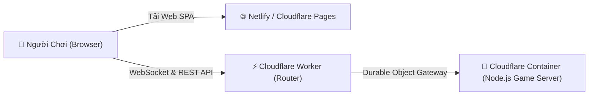

# 🐱💣 Exploding Kittens Online

[](https://github.com/your-username/exploding-kittens/actions/workflows/ci.yml)
[](https://nodejs.org/)
[](https://react.dev/)
[](https://boardgame.io/)
[](https://www.typescriptlang.org/)
[](https://www.docker.com/)

Một phiên bản web multiplayer trực tuyến hoàn chỉnh của trò chơi board game đình đám **Exploding Kittens (Mèo Nổ)**, hỗ trợ chơi đa người chơi thời gian thực với **10 Gói Mở Rộng (Decks)**, giao diện tối ưu hóa cho cả máy tính và di động, hỗ trợ đầy đủ tiếng Việt và các cơ chế tương tác hiện đại.

---

## 🌟 Tính Năng Nổi Bật (Key Features)

- 🎮 **Chơi Đa Người Thời Gian Thực (Real-time Multiplayer):** Sử dụng engine `boardgame.io` với Socket.IO cho độ trễ cực thấp, quản lý trạng thái đồng bộ và tự động kết nối lại khi rớt mạng.
- 🎯 **4 Chế Độ Chơi (Game Modes):**
  - **Mode 0 - Tiêu Chuẩn (Normal):** Luật chơi cơ bản với tùy chọn kích hoạt bất kỳ gói mở rộng nào (2 - 10 người).
  - **Mode 1 - Đấu Nhanh (Quick Play 1v1):** Cố định 2 người chơi, chỉ sử dụng Bộ Tiêu Chuẩn rút gọn chính xác 16 lá và 2 Mèo Nổ.
  - **Mode 2 - Liên Hoàn (Combo Chain x2 x3):** Đánh bài có cơ hội x2, x3 hiệu ứng (tấn công 4-6 lượt, xin xỏ 2-3 lá, nhìn/đảo 6-9 lá tương lai, cướp 2-3 lá).
  - **Mode 3 - Đấu Đội (Team-Up):** Chia 2 phe Đội Đỏ 🔴 và Đội Xanh 🔵 (2, 4, 6, 8 người), đội chiến thắng khi toàn bộ đối phương bị loại.
- 🤖 **Đấu Bot:** Chọn 1–10 bot với 5 mức Dễ, Vừa, Khó, Địa Ngục và Châu Á. Bot tự đánh bài, phản ứng Nope, chọn mục tiêu, cho bài, gỡ bom và xử lý các bộ mở rộng. Mức Châu Á xét mọi cách sắp xếp tối đa 5 lá tương lai để tối ưu các lượt rút dự kiến. Các cơ chế nội bộ và ngoại lệ về thông tin của bot được ghi đầy đủ trong [CHANGELOGS.MD](CHANGELOGS.MD).
- 🃏 **Hệ Thống 10 Gói Bài (10 Expansion Decks):** Tùy ý phối hợp Bộ Tiêu Chuẩn cùng 9 Gói Mở Rộng phong phú với hàng chục lá bài hành động độc đáo.
- 🛡️ **Cơ Chế Phòng Thủ Tráo Bài 10 Giây (Hand Shuffle Defense):** Khi bị đối thủ tấn công cướp hoặc hủy bài (Steal, Discard, Buried Treasure, Mark), người bị nhắm đến có 10 giây để kéo thả tráo vị trí bài trên tay hoặc dùng tính năng xáo bài ngẫu nhiên tự động.
- 📱 **UX/UI Hiện Đại & Mượt Mà:**
  - Bảng thao tác cạnh bên (Side Action Bar) tiện lợi với nút Đánh Bài Đã Chọn, Kết Thúc Lượt / Rút Bài, Bỏ Chọn.
  - Hiển thị viền ngọc lục bảo (Glow Effect) gợi ý các lá bài hợp lệ có thể đánh ngay trong lượt.
  - Thanh thông báo sự kiện trực tiếp (Action Notification Toast) hiển thị các hành động như đánh bài, gỡ bom, người chơi phát nổ.
  - Sổ tay luật chơi (Rulebook) tích hợp thanh điều hướng nhanh chuyển ngay đến từng gói bài.
  - Hệ thống Chat trực tiếp và chế độ Khán giả (Spectator Mode).
  - Tối ưu 100% tiếng Việt với font chữ `Be Vietnam Pro` chuẩn mực.
- 🚀 **Sẵn Sàng Triển Khai Online (Cloud & Docker Ready):**
  - Hỗ trợ chạy máy chủ hợp nhất (Unified Server): 1 tiến trình Node.js duy nhất vừa phục vụ frontend React vừa chạy backend game server trên cùng một cổng (`PORT`).
  - Đi kèm `Dockerfile` đa tầng tối ưu và `docker-compose.yml` chạy ngay bằng 1 lệnh.
  - Endpoint kiểm tra sức khỏe hệ thống `/health` tương thích các nền tảng Cloud (Railway, Render, Fly.io, Kubernetes).

---

## 🃏 Danh Sách 10 Gói Bài (The 10 Decks)

Để chơi một mình: từ sảnh chọn **🤖 Đấu Bot**, chọn số bot, độ khó và bộ bài, bấm **Vào bàn đấu**, rồi **Bắt đầu trò chơi**. Trận bot chạy trong trình duyệt và không cần game server. Có thể chơi lại hoặc rời trận; tải lại trang sẽ kết thúc trận hiện tại. Chạy `npm run test:bots` để kiểm tra bot qua các ván mô phỏng và các bước tương tác.

Kiểm tra toàn bộ logic bằng `npm test`, kiểm tra mã bằng `npm run lint`. Sau `npm run build`, chạy `npm run test:server` để kiểm tra HTTP, multiplayer và lưu/khôi phục trận qua server thật; bài kiểm tra dùng cổng và thư mục lưu trữ tạm riêng. `npm run server:dev` tự biên dịch và khởi động lại backend khi source server/common thay đổi.

| # | Gói Bài (Deck) | Số Lá | Điểm Nhấn Cơ Chế |
|---|----------------|:-----:|------------------|
| 1 | **Original Deck** (Bộ Tiêu Chuẩn) | 56 | Exploding Kitten, Defuse, Attack, Skip, Favor, Shuffle, See the Future 3x, Nope, Cat Cards. |
| 2 | **Imploding Kittens** | 20 | Imploding Kitten (lật ngửa đếm ngược nổ tức thì), Targeted Attack, Feral Cat, Alter the Future 3x, Draw from the Bottom, Reverse. |
| 3 | **Streaking Kittens** | 15 | Streaking Kitten (bí mật giấu Mèo Nổ trên tay), Garbage Collection, Super Skip, Curse of the Cat Butt, See the Future 5x, Alter the Future 5x, Catomic Bomb. |
| 4 | **Barking Kittens** | 20 | Cặp bài Barking Kittens, Phụ kiện Vương miện Tower of Power (kho bài dự trữ 6 lá), I'll Take That, Potluck, Bury. |
| 5 | **Zombie Kittens** | 22 | Cơ chế Xác Sống (Undead): Người chết không bị loại, Zombie Kitten hồi sinh, Feed the Dead, Grave Robber, Clairvoyance, Clone. |
| 6 | **Aggro Kittens** | 11 | Lối chơi tấn công dữ dội: Reverse Attack (2x), Buried Treasure (chôn tài nguyên xuống đáy), I'll Take It From Here (cướp quyền đặt Mèo Nổ). |
| 7 | **Attacking Kittens** | 14 | Ép đối thủ nhận nhiều lượt dồn dập: Slap (1x, 2x, 3x), Annoy (khóa 2 lá bài đối thủ), Steal a Card. |
| 8 | **Defending Kittens** | 14 | Phòng thủ tối đa & Chống Xáo Bài: See The Future 1x, Curse of Crystal Corn (cấm/hủy Shuffle), Kitten Roll Call (lôi toàn bộ bom lên đỉnh). |
| 9 | **Creepy Kittens** | 11 | Thao túng đỉnh và đáy bộ bài: Flip Four (lật úp/ngửa công khai 4 lá đỉnh), Look at the Bottom, Draw From Anywhere, Choose Your Fate. |
| 10 | **Timebomb Kittens** | 15 | Timebomb Kitten (đặt trước mặt đếm ngược 3 lượt nổ), Defuse Timebomb, Blind (cấm đánh bài), Search (xem 5 chọn 1), Discard (hủy 2 lá đối thủ), Copycat (sao chép hiệu ứng). |

---

## 🛠️ Yêu Cầu Cài Đặt (Prerequisites)

- **Node.js**: Phiên bản 20.x hoặc 22.x trở lên.
- **npm**: Phiên bản 10.x trở lên.
- (Tùy chọn) **Docker** & **Docker Compose**: Nếu muốn triển khai dạng container.

---

## 🚀 Hướng Dẫn Chạy Cục Bộ (Local Development)

### 1. Cài Đặt Thư Viện

```bash
git clone https://github.com/your-username/exploding-kittens.git
cd exploding-kittens
npm install
```

### 2. Chạy Môi Trường Phát Triển

Dự án yêu cầu chạy 2 tiến trình đồng thời (hoặc mở 2 cửa sổ terminal):

```bash
# Terminal 1: Chạy Máy Chủ Game (Backend)
npm run server:dev

# Terminal 2: Chạy Giao Diện Web (Frontend Vite)
npm run dev
```

- **Frontend Client**: Truy cập tại [http://localhost:5173](http://localhost:5173)
- **Backend Server**: Chạy tại `http://localhost:51399`

---

## 🏗️ Biên Dịch Cho Production (Production Build)

```bash
# Biên dịch cả Client và Server
npm run build
npm run build:server

# Chạy máy chủ đơn nhất (Unified Server phục vụ cả web và game engine)
npm run server
```

---

## 🐳 Triển Khai Bằng Docker (Docker Deployment)

### Chạy Ngay Với Docker Compose:

```bash
docker compose up -d --build
```

Mở trình duyệt truy cập: `http://localhost:51399`

### Chạy Với Docker Thuần:

```bash
# 1. Build image
docker build -t exploding-kittens:latest .

# 2. Chạy container
docker run -d -p 51399:51399 -e PORT=51399 --name exploding-kittens exploding-kittens:latest
```

---

## ☁️ Triển Khai Lên Đám Mây (Cloud & Webgame Deployment Guide)

Trò chơi bao gồm 2 thành phần chính: **Frontend (React SPA)** và **Backend Game Server (Node.js + WebSockets / Socket.IO)**.

---

### ⚡ Phương Án 1: Deploy Backend Trực Tiếp Lên Cloudflare (Khuyên Dùng)

Dự án đã được tích hợp sẵn cấu hình **Cloudflare Containers** (sử dụng `@cloudflare/containers`, Durable Objects và `wrangler.jsonc`) để chạy thẳng Docker backend Node.js + WebSocket trên mạng lưới Edge toàn cầu của Cloudflare:



#### Cách triển khai Backend lên Cloudflare:
1. Đăng nhập tài khoản Cloudflare trên máy tính:
   ```bash
   npx wrangler login
   ```
2. Khởi chạy deploy container backend lên Cloudflare:
   ```bash
   npm run deploy:cloudflare
   ```
   Wrangler sẽ tự động:
   - Build `Dockerfile` thành container image.
   - Deploy lên Cloudflare Containers và liên kết với Durable Object `GameContainer`.
   - Cấp một URL HTTPS/WSS cho Worker (ví dụ: `https://exploding-kittens-backend.<your-subdomain>.workers.dev`).
3. Dán URL backend trên vào biến `VITE_API_URL` khi deploy Frontend.

#### 🔒 Tùy chọn 100% Miễn Phí: Cloudflare Tunnel (`cloudflared`):
Nếu tài khoản Cloudflare của bạn chưa đăng ký gói Containers:
1. Chạy game server trên bất kỳ máy nào (máy tính cá nhân, homelab hoặc VPS):
   ```bash
   docker compose up -d
   ```
2. Cài đặt `cloudflared` và tạo tunnel nối ra Cloudflare:
   ```bash
   cloudflared tunnel --url http://localhost:51399
   ```
   Cloudflare sẽ cấp cho bạn một domain HTTPS/WSS bảo mật toàn cầu (hoặc gắn vào custom domain trên Cloudflare của bạn) hoàn toàn miễn phí.

---

### 🌐 Phương Án 2: Deploy Frontend Lên Netlify (hoặc Cloudflare Pages)

1. Đẩy code lên GitHub repository của bạn.
2. Truy cập [Netlify](https://app.netlify.com/) -> **Add new site** -> **Import an existing project** -> Chọn GitHub repo.
3. Cấu hình build (đã có sẵn file `netlify.toml`):
   - **Build command:** `npm run build`
   - **Publish directory:** `dist`
4. Cấu hình biến môi trường (**Environment variables**):
   - `VITE_API_URL`: Điền địa chỉ Cloudflare backend của bạn (ví dụ: `https://exploding-kittens-backend.workers.dev`).
5. Bấm **Deploy**. Netlify sẽ tự động build và cấp phát URL dạng `https://ten-trang-web.netlify.app`.

*(Mẹo: Bạn cũng có thể kéo thả thư mục `dist` lên **Cloudflare Pages** để chạy 100% hệ sinh thái Cloudflare cho cả frontend lẫn backend).*

---

### 📦 Lưu Trữ & Tối Ưu Với Cloudflare R2 (Object Storage / CDN)

> [!NOTE]
> **Lưu ý về Cloudflare R2:** Cloudflare R2 là dịch vụ **Lưu trữ đối tượng (Object Storage)** tương tự Amazon S3, dùng để lưu trữ file tĩnh, hình ảnh và backup. R2 **không thể tự chạy code Node.js hay mở kết nối WebSocket của game server**.

Trong dự án này, bạn có thể ứng dụng Cloudflare R2 rất hiệu quả theo 2 cách:
1. **Làm CDN Asset Cho Toàn Bộ Hình Ảnh Thẻ Bài & Avatars:**
   - Upload toàn bộ thư mục `public/assets/` lên Cloudflare R2 bucket.
   - Bật tính năng **Public Access / Custom Domain** trên R2 (ví dụ `https://cdn.yourgame.com`).
   - Cung cấp tốc độ tải hình ảnh siêu tốc, giảm tối đa băng thông cho hosting chính.
2. **Sao Lưu Database Trận Đấu (Match State Backup):**
   - Định kỳ đồng bộ thư mục `storage/data/` (FlatFile persistence) lên R2 để lưu trữ lịch sử trận đấu an toàn.

---

### 🚀 Phương Án 2: Triển Khai Hợp Nhất 1 Cổng (Unified Single-Port Container)

Dự án đã được tích hợp sẵn máy chủ hợp nhất: 1 tiến trình Node.js vừa phục vụ file tĩnh frontend vừa chạy backend game server trên cùng một cổng.

#### Triển khai trên VPS / Server riêng:
```bash
# Chạy với Docker Compose
docker compose up -d --build
```

#### Hoặc sử dụng PM2 + Nginx Reverse Proxy:
```bash
# Biên dịch
npm run build && npm run build:server

# Khởi chạy bằng PM2
pm2 start dist/server/server/server.js --name "exploding-kittens"
```

Cấu hình Nginx Reverse Proxy hỗ trợ WebSocket:
```nginx
server {
    listen 80;
    server_name your-domain.com;

    location / {
        proxy_pass http://127.0.0.1:51399;
        proxy_http_version 1.1;
        proxy_set_header Upgrade $http_upgrade;
        proxy_set_header Connection "upgrade";
        proxy_set_header Host $host;
        proxy_cache_bypass $http_upgrade;
    }
}
```

---

## ⚙️ Biến Môi Trường (Environment Variables)

| Biến | Mặc định | Mô tả |
|------|----------|-------|
| `PORT` | `51399` | Cổng lắng nghe của máy chủ trong môi trường production / cloud. |
| `SERVER_PORT` | `51399` | Cổng dự phòng của game server. |
| `SERVER_ORIGINS` | `*` | Danh sách domain được phép gọi API CORS (phân tách bởi dấu phẩy, hoặc `*`). |
| `VITE_API_URL` | *(Tự nhận diện origin)* | Địa chỉ API backend nếu chạy frontend và backend ở 2 domain riêng biệt. |

---

## 📐 Kiến Trúc Dự Án (Architecture)

Dự án áp dụng mô hình phân tách nghiêm ngặt giữa **State Model (Plain JSON)** và **Object-Oriented Entity Wrapper**:

```
exploding-kittens/
├── public/                 # Static assets (hình ảnh thẻ bài, avatar decks)
├── src/
│   ├── common/             # [Core Game Logic] Chia sẻ giữa client và server
│   │   ├── constants/      # Tên bài, định danh stages, phases
│   │   ├── entities/       # OOP Wrappers (TheGame, Player, Card, DeckType)
│   │   ├── models/         # TypeScript Interfaces thuần túy (IGameState, IPlayer)
│   │   ├── moves/          # Các nước đi trong game (draw, play, attack, shuffle...)
│   │   └── registries/     # Card Registry & Deck Registry (đăng ký thẻ và bộ bài)
│   ├── client/             # [React Frontend]
│   │   ├── components/     # UI Components (Board, Table, Player, Overlays, Lobby)
│   │   ├── context/        # React Contexts (GameContext, AnimationContext, Selection)
│   │   └── entities/       # TheGameClient (mở rộng TheGame cho giao diện người dùng)
│   └── server/             # [boardgame.io Server]
│       └── server.ts       # Unified HTTP & WebSocket Game Server
├── Dockerfile              # Multi-stage production Docker build
├── docker-compose.yml      # Docker compose configuration
└── README.md
```

---

## ⚖️ Bản Quyền & Miễn Trừ Trách Nhiệm (Disclaimer)

- Dự án này là một tác phẩm fan-made được phát triển cho mục đích học tập, nghiên cứu và giải trí phi thương mại.
- Trò chơi gốc **Exploding Kittens®** thuộc bản quyền của [Exploding Kittens Inc.](https://www.explodingkittens.com/).
- Vui lòng mua bộ board game vật lý chính hãng để ủng hộ các tác giả gốc!

---

*Chúc bạn có những giây phút chơi game kịch tính và tràn ngập tiếng cười cùng bạn bè!* 🐱💥
